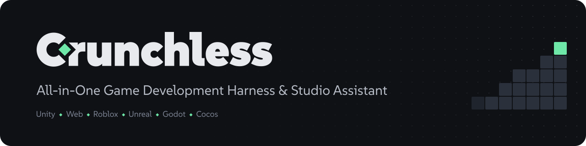

## Crunchless: a game dev kit for coding agents

Crunchless installs into your coding agent as plugins and gives it tested procedures for making and shipping a game. It works in Claude Code, Codex, GitHub Copilot, Cursor, and Antigravity, on Unity, web, Roblox, Unreal, Godot, and Cocos.

It comes in three editions: a free core under MIT, Builder ($10, one time), and Studio ($100, one time). Three commands show how it works:

- `/cl-core:cl-audit` (free) ranks what to fix in your game.
- `/cl-core:cl-ship` (free) gives one ship or no-ship decision, with the evidence behind each line.
- `/cl-core:cl-port` (Builder) wires the game to a web portal such as Poki or CrazyGames, checked against the portal's own docs. Then a preflight boots the game in a fake browser and tests 22 portal rules.

### Benchmark

Get a small web game ready for the Poki portal, ten times with the Builder edition and ten times without the kit, in Claude Code. With the kit, 10 of 10 builds passed every automated Poki check and 9 of 10 passed all 24 checks. Without it, none did either. Without the kit no agent ran the game; the kit's preflight runs the same 20 automated checks. The free core wasn't tested. [Rubric](https://github.com/crunchless-kits/agentic-gamedev/blob/main/docs/benchmarks/ship-to-poki/RUBRIC.md) and [report](https://github.com/crunchless-kits/agentic-gamedev/blob/main/docs/benchmarks/ship-to-poki/REPORT.md).

### Try It Free

In Claude Code, add the free core, install its main plugin, `cl-core`, and run the audit in your game's folder:

```
/plugin marketplace add crunchless-kits/agentic-gamedev
/plugin install cl-core@crunchless
/cl-core:cl-audit
```

For Codex, Copilot, Cursor, and Antigravity, follow the [install steps in the free core's README](https://github.com/crunchless-kits/agentic-gamedev#readme).

### Editions

| Edition | What it holds | Price |
|---|---|---|
| [Free core](https://github.com/crunchless-kits/agentic-gamedev) | Project audits for Unity, web, Roblox, Unreal, Godot, and Cocos, brainstorming, a scope guard that stops your agent from building what you didn't ask for, and shipping on itch.io | Free, MIT |
| [Builder](https://github.com/sponsors/crunchless-kits) | The skills that build, test, and ship the game: engine setup, gameplay systems, QA agents that try to break your build, and release checks for stores and portals | $10, one time |
| [Studio](https://github.com/sponsors/crunchless-kits) | Everything in Builder, plus monetization, analytics, live ops, compliance, marketing, and a producer agent that tracks milestones and tasks | $100, one time |

To get Builder or Studio:

1. Open [GitHub Sponsors](https://github.com/sponsors/crunchless-kits), choose the **One-time** tab, and pick the $10 Builder tier or the $100 Studio tier.
2. Accept the invitation to the private repository. It arrives by email and in your GitHub notifications, for the account you sponsored with.
3. Install it the same way as the free core, using the private repository's name: `crunchless-kits/agentic-gamedev-builder` or `crunchless-kits/agentic-gamedev-studio`. Its README has the exact commands.

### Links

- **Website, with every edition in detail:** [crunchless-kits.github.io/agentic-gamedev](https://crunchless-kits.github.io/agentic-gamedev/)
- **Questions about any edition:** [GitHub Discussions](https://github.com/crunchless-kits/agentic-gamedev/discussions) on the free core's repository
